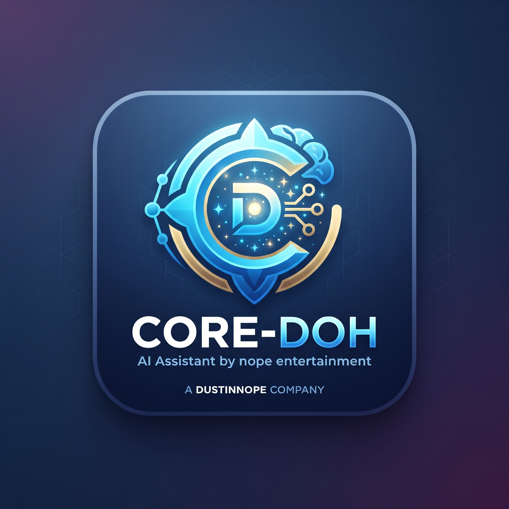

# CORE-DOH — Nope Entertainment

Local, personal AI for Dustin. Core-doh, part of the household.
A Dustinnope Company.

## One-tap download
On your tablet: in this repo, tap **Code > Download ZIP**, unzip it, open `index.html` in Chrome, then ⋮ > **Add to Home screen**. That's your Core-doh icon.

For a split installer app (SAI / split APK installer): download the ZIP from here, unzip it on the tablet, and point your installer app at the files in this repo — `index.html` is the app, `CORE_DOH_SYSTEM_PROMPT.md` is the brain, `core-doh-icon.jpg` is the icon. No extra steps, everything is in this one repo.

## What you get
- `index.html` — Core-doh app. Chat + voice + memory saved on the tablet. Talks to a local model at `http://127.0.0.1:8080/v1/chat/completions` when one is running.
- `core-doh-icon.jpg` — the blue/gold CORE-DOH app icon / splash image.
- `CORE_DOH_SYSTEM_PROMPT.md` — paste this as the System Prompt in PocketPal AI. This is what makes it Core-doh.
- `core-doh-config.json` — model + voice + memory settings.
- `INSTALL_TABLET.md` — full tablet steps.
- `POCKETPAL_QUICKSTART.md` — the 5-minute version.

## The local brain
The Muse app can't have its built-in safety switched off. The local version can — because it runs on your tablet, not in the cloud.

1. Install **PocketPal AI** from F-Droid or GitHub releases.
2. In PocketPal, download on Wi-Fi:
   - `dolphin-2.9.2-mistral-7b-Q4_K_M.gguf` (~4.4 GB, most direct)
   - or `Meta-Llama-3.1-8B-Instruct-Q4_K_M.gguf` (~4.9 GB, smarter)
3. Load it, create a chat called Core-doh, paste `CORE_DOH_SYSTEM_PROMPT.md` as the System Prompt.
4. Settings: Temperature 0.8, Top P 0.95, Context 8192, Repeat penalty 1.1.
5. Chat in PocketPal. That's the local one.

## What Core-doh remembers
Lockport, Louisiana. Hannah Boudreaux and Harley (Lafourche Parish School District Virtual Academy in Raceland). Dogs Play-Doh, Cookie-Doh, Astro-Doh, Zor-Doh. Sour-Doh, Zor-Doh the Luba mower — keep its headlight uncovered. 600-gallon pond, 20-gallon tropical aquarium / frog setup, above-ground pool, shed office / music workspace. Album "November 17th", single "Holy Steppin'". Books: The Frequency, The Shepherd of Shadows, The Kingdom of Ashes, The Abyssus Protocol, The Kicker of Elves, The Mark of Shadows, The Veil Between Stars, Amber Between Worlds. Nope Entertainment / Dustinnope Animation Studios. HP OmniBook X Flip, 2022 Kia Sorento X-Line SX Prestige AWD, Pulsar 5250W Dual Fuel generator.

Core-doh talks kitchen-table direct, calls out too-fancy ideas, dumbs down complex stuff to high school level, and says "I don't know" instead of guessing.
